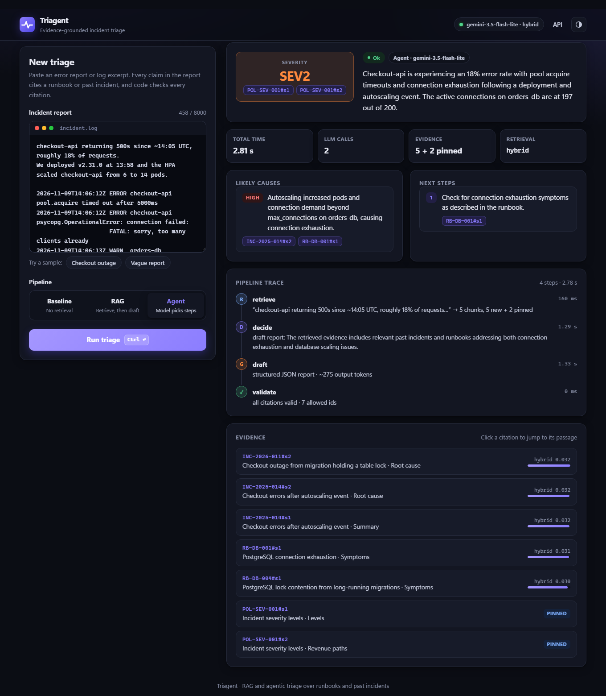

# Triagent

[](https://github.com/adi-btw/triagent/actions/workflows/ci.yml)

**Evidence-grounded incident triage.** Paste an error report or a short log excerpt. Triagent searches a corpus of synthetic runbooks
and past incident reports, and returns a **structured triage report**: severity (SEV1–4), likely causes,
and next steps. **Every claim cites a retrieved passage**, and when the corpus doesn't cover the
problem, the report **says so** instead of guessing.

It's built in three stages, and each one can be measured against the others:

| Stage | What it adds | Read |
|---|---|---|
| 1. Basic RAG | Chunking, local embeddings, vector / BM25 / hybrid retrieval, a report checked against a schema, and a **citation allow-list** enforced in code | [docs/retrieval.md](docs/retrieval.md), [docs/generation-and-validation.md](docs/generation-and-validation.md) |
| 2. Agentic workflow | The model chooses to *draft*, *rewrite the query and retry once*, or *ask one clarifying question*. The app enforces every limit. Each step shows in the UI | [docs/agent.md](docs/agent.md) |
| 3. Evaluation | 32 labeled cases; the same model compared with no retrieval, with RAG, and as an agent; LLM-as-judge for claim support; bootstrap CIs | [docs/evaluation.md](docs/evaluation.md), [data/eval/README.md](data/eval/README.md) |
| 4. QLoRA (optional) | Dataset and hardware requirements for fine-tuning a small severity classifier, written up before any decision to build it | [finetune/README.md](finetune/README.md) |



**Results** (32 labeled incidents, same model in every mode): exact severity rises from **38%** with no
retrieval to **79%** with RAG and **93%** with the agent. Correct abstention on incidents the docs don't
cover goes from **0/7** to **7/7**, with no false abstentions. Only **8%** of the agent's claims were judged unsupported by
their cited passage. [Details](#end-to-end-no_retrieval-vs-rag-vs-agent).

## Architecture

```
                 INGESTION (python -m scripts.ingest, idempotent)
 data/corpus/*.md ─► front-matter ─► chunk per "## " section ─► embed (bge-small, local) ─► store
                                     id = DOC-ID#sN                (only changed chunks)     │
                                                                                            ▼
                                                     ┌─────────────────────────────────────────┐
                                                     │ memory store (numpy + BM25, default)    │
                                                     │   or Postgres + pgvector + tsvector     │
                                                     └───────────────────┬─────────────────────┘
 POST /triage  ──────────────────────────────────────────────────────────┼───────────────────────
  mode=no_retrieval:   incident ─────────────────────────────► LLM ─► validate
  mode=rag:            incident ─► retrieve top-k + pinned ─► LLM ─► validate
  mode=agent:          incident ─► retrieve ─► DECIDE ─┬─ draft ──► LLM ─► validate ─► repair ×1
                                      ▲                ├─ rewrite query (×1) ─► retrieve ─► merge ─┘
                                      └────────────────┴─ ask clarifying question (×1) ─► 200 needs_clarification

  validate (deterministic code): schema parse · cited ids ⊆ retrieved ids · every cause/step cited ·
                                 severity/abstention consistency     → 422 with violations if any fail
  pinned: the severity policy is added to every request's evidence, never left to ranking
  every response carries a trace: steps, retrieved ids + scores, queries, timings, LLM call count
```

**Who decides what.** The model chooses among allowed actions and writes the report. Code owns
everything else: the step budget (≤ 4 LLM calls), one query rewrite, one clarifying question, how
evidence is merged, the citation allow-list, and one repair attempt. It's the same idea as asking a
human to confirm write actions in a tool-calling app: **the model proposes and deterministic code decides.**

## Quickstart

Requires Python 3.11+. Docker is optional: the default store is in-memory.

**PowerShell (Windows)**
```powershell
python -m venv .venv; .venv\Scripts\Activate.ps1
pip install -e ".[dev]"
copy .env.example .env      # then set GEMINI_API_KEY, or set LLM_PROVIDER=fake to try it offline
python -m scripts.ingest    # downloads the ~130 MB embedding model once, then builds .cache/index.json
uvicorn app.main:app --reload
```

**bash (macOS/Linux)**
```bash
python -m venv .venv && source .venv/bin/activate
pip install -e ".[dev]"
cp .env.example .env
python -m scripts.ingest
uvicorn app.main:app --reload
```

Open http://localhost:8000. Click a sample incident, pick a mode, and submit. Click a citation chip to see the
passage, and read the **Steps** timeline to see what the agent chose. The API docs are at `/docs`.

From the terminal:
```bash
python -m scripts.triage_cli data/demo_incident.txt --mode agent
```

**Optional: Postgres + pgvector**
```bash
docker compose up -d
STORE_BACKEND=postgres python -m scripts.ingest --backend postgres
```

## Deployment

`Dockerfile` builds a single container with the embedding model and index baked in, and
`render.yaml` deploys it to Render's free tier from this repository. The container runs in **demo
mode with no API key**, so hosting it costs nothing. It replays recorded sample answers and returns
403 for anything else. If a key is ever added, demo mode guards it in three ways:
- The UI's sample incidents replay pre-computed answers, which are instant and free.
- Each visitor gets 20 requests an hour.
- A hard daily cap limits how many calls can reach the model.

`/?sample=checkout&mode=agent` deep-links straight to a finished report. See [docs/deploy.md](docs/deploy.md).

## Continuous integration

Every push runs [CI](.github/workflows/ci.yml):

| Job | What it proves |
|---|---|
| Lint and unit tests (Python 3.11, 3.12) | `ruff`, 360+ hermetic tests with fakes (no network), and the prompt-injection red team |
| Retrieval regression gate | Builds the real index and fails if hybrid primary-doc hit, recall or MRR drops below the thresholds in `eval/retrieval_gate.py` |
| Postgres + pgvector | Runs the store integration tests against a live `pgvector` service, then ingests the corpus into Postgres and runs the same retrieval gate on it |
| Docker image | Builds the image, starts it with an *invalid* API key, and checks that every sample incident is served from the demo cache in every mode |

No CI job calls an LLM, so CI is free and deterministic. The end-to-end eval is run on demand (below).

## Tests

```bash
pytest -q                      # fast tests: fakes only, no network, no key
pytest -q -m slow              # real embedding model (and live Gemini if GEMINI_API_KEY is set)
pytest -q -m postgres          # needs docker compose up -d
ruff check .
```

## Results

### Retrieval (measured, no LLM involved)

`python -m eval.retrieval_eval --k 5` scored 25 cases. The 7 abstention cases have no target document, so they're skipped. Full report:
[eval/results/retrieval-latest.md](eval/results/retrieval-latest.md).

| Metric @5 | vector | keyword (BM25) | hybrid (RRF) |
|---|---|---|---|
| Doc recall | 52% [44–59] | 61% [55–67] | 59% [55–64] |
| Chunk recall | 53% [41–65] | 66% [56–75] | 61% [52–70] |
| Primary-doc hit | 88% [72–100] | 100% | 100% |
| MRR (chunk) | 71% [56–86] | 80% [68–91] | 78% [65–90] |

The 95% bootstrap confidence intervals overlap, and with n=25 a gap under about 10 points isn't meaningful.
The consistent pattern is that **pure vector search misses the most important document in 3 of 25 cases,
and keyword or hybrid search never does.** Incident text is full of exact tokens (`too many clients`,
`max_connections`, `EAI_AGAIN`) that embeddings blur. The demo incident is one of the misses:
near-miss documents about a table-lock outage and payment timeouts push the connection-exhaustion runbook out of
the vector top 5. **`RETRIEVAL_MODE` therefore defaults to `hybrid`.**

**A cross-encoder reranker was tried and not adopted.** Reranking hybrid's top 20 with an MS MARCO
cross-encoder cut primary-document hit from 100% to 64%. The best of four models (jina-v1-turbo) tied
hybrid within noise and lost one primary hit. Web-trained rerankers don't value the exact log-token
matches that dominate this corpus. The stage stays available behind `RERANK=true`, and the
`+rerank` eval variants re-run the comparison. See [docs/retrieval.md](docs/retrieval.md).

### End-to-end (no_retrieval vs RAG vs agent)

`python -m eval.run_eval` ran all 32 cases in three modes, with the same model in each:
`gemini-3.5-flash-lite`, temperature 0, hybrid retrieval, k = 5. All 96 units returned `ok`, and no
judge call failed. Full report: [eval/results/latest.md](eval/results/latest.md).

| Metric | no retrieval | RAG | agent |
|---|---|---|---|
| Severity exact [95% CI] | 38% (11/29) [21–55] | 79% (23/29) [66–93] | **93% (27/29) [83–100]** |
| Correct abstention (7 uncovered incidents) | 0/7 | 5/7 | **7/7** |
| False abstention (20 answerable) | 0/20 | 0/20 | 0/20 |
| Claims supported by cited passage (judge) [95% CI] | 0% (by construction) | 67% [53–79] | **75% [64–84]** |
| Claims *not* supported | 100% | 16% | **8%** |
| Clarifying question on ambiguous cases | n/a | n/a | 4/5, and 0/27 on clear ones |
| Citations of passages the model wasn't shown | 0 | 0 | 0 |
| Latency p50 / p95 (fresh calls) | 1.1 s / 1.6 s | 1.7 s / 3.0 s | 2.1 s / 4.3 s |
| LLM calls / tokens per case | 1 / 591 | 1 / 1,779 | 2.4 / 3,790 |

What the numbers say:

- **Retrieval is what makes severity right.** Without documents the model rates severity by
  intuition, and over-rates. 8 of 12 SEV3 incidents became SEV2, because it has never seen the severity
  policy. With RAG, every answerable case gets the exact severity (20/20), and the confusion matrix is
  diagonal apart from abstentions.
- **Without retrieval the model never says "I don't know."** It confidently triaged all 7 incidents
  the corpus doesn't cover (Kafka, Elasticsearch, mobile crashes…). RAG abstained on 5 of 7 and the
  agent on 7 of 7, and neither abstained on any answerable case.
- **The agent's gain comes mostly from ambiguous incidents.** It asked a clarifying question on 4 of
  5 vague reports, then got the severity right on 4 of 5. RAG has to answer the vague text, and got 0
  of 5. On answerable cases RAG and the agent tie (20/20 severity, 75% supported claims). The agent
  costs about 2.4× the LLM calls and 2× the tokens.
- **Read the intervals.** The severity CIs for RAG and the agent overlap, and the abstention gap is
  2 cases. The robust findings are retrieval vs no retrieval, and the agent's behavior on ambiguous inputs.

Caveats: the judge is the same model as the generator, so claim support may be inflated by self-preference. The
labels come from a single labeller, and the corpus and cases share an author (see Known limitations). The run
finished in two passes after the key's credits ran out partway through. The second pass replayed answered calls
from the LLM cache, so latency above comes from the first pass's fresh calls. Details are in the report.

**How far can the judge be trusted?** `python -m eval.judge_calibration` draws 40 judged
claims, stratified by verdict, for blind re-labelling (see [docs/evaluation.md §9](docs/evaluation.md)).
A first pass was labelled by a second model (Claude), not a person:

- **Judge precision on "supported": 14/14.** The 75% "claims supported" figure above is not
  inflated by a lenient judge.
- **The judge is stricter on everything else.** 16 of its 26 "partially" or "not supported"
  verdicts would get a more generous label, mostly claims that add an incident detail (a slot
  name, a version) on top of a correctly cited mechanism.
- **Agreement:** kappa 0.28 across three classes (fair), 0.57 for supported vs not (moderate).
  See [eval/results/judge-calibration-second-model.md](eval/results/judge-calibration-second-model.md).

Two models can share blind spots, so human labels are still the reference. The blind labelling page
and the scorer are ready for them.

Reproduce:
```bash
python -m eval.run_eval --delay 2     # ~190 LLM calls; reruns replay answered calls from .cache/llm
```

### Hosted model vs a local 3B model

The same 32 cases were run against qwen2.5:3b. It runs locally through Ollama on a laptop
CPU, with no API key and no cost. Both runs use the same prompts and retrieval; only the
model changes. See [eval/results/model-comparison.md](eval/results/model-comparison.md).

| RAG mode | gemini-3.5-flash-lite | qwen2.5:3b (local CPU) |
|---|---|---|
| Severity exact | 79% (23/29) | 66% (19/29) |
| Severity within one level | 79% (23/29) | 93% (27/29) |
| Correct abstention (7 uncovered) | 71% (5/7) | 14% (1/7) |
| Report accepted by validator | 100% (32/32) | 75% (24/32) |
| Latency p50 (uncached) | 1.7 s | 34 s |

- **The small model is close on severity but rarely abstains.** It answered 6 of the 7
  incidents the corpus doesn't cover.
- **The validator caught the rest.** The 8 rejected reports cite whole document ids or
  chunks that were never retrieved, or set severity without citing the policy. All 8 became
  `invalid_output` instead of reaching a user.
- Qwen's claims weren't judged: a paid judge would cost money, and self-grading isn't
  credible. In agent mode, 4 calls hit the 120 s timeout on CPU.

```bash
ollama pull qwen2.5:3b
LLM_PROVIDER=openai_compat OPENAI_MODEL=qwen2.5:3b python -m eval.run_eval --no-judge
python -m eval.compare_models eval/results/runs/<gemini-run> eval/results/runs/<qwen-run>
```

### Prompt-injection red team

`python -m eval.redteam` replays 16 injection attacks, delivered through poisoned runbooks or
through the incident text, using a stand-in model that **obeys every injected instruction**.
That measures what the code guarantees whatever the model does. It's free and deterministic,
and it runs in CI.

| Defenses | Attacks that succeed |
|---|---|
| None (model output shown as-is) | 16/16 |
| Citation validator (stage 1) | 12/16 |
| Validator + output guards | **2/16** |

The citation validator stops forged citations, but not a poisoned runbook whose payload is cited
*correctly*. The output guards close that gap:
- a severity must cite the severity policy;
- no destructive commands (`DROP TABLE`, `rm -rf`, `curl … | sh`, disabling auth…);
- no links outside allowed domains;
- no leaked system prompt.

On all 96 real eval reports the guards flag **0 false positives**. The 2 remaining attacks need
semantic understanding to catch, and are documented as residual risk. See
[docs/security.md](docs/security.md).

## Reviewer feedback loop

Every report in the UI asks **"Was this triage right?"** A reviewer can confirm it, or
correct the severity, say it should have abstained, and flag citations that don't support
their claim. The server stored the triage it showed under a `triage_id`, so feedback
always points at the exact report, model and prompt version. Two commands close the loop:

```bash
python -m eval.feedback report         # acceptance by mode/model/prompt, severity corrections, flagged chunks
python -m eval.feedback export-cases   # corrections -> validated candidate eval cases, for human review
```

Accepted candidates join `data/eval/cases.jsonl`, so the next model or prompt change is
measured on the incidents people actually triaged. See [docs/feedback.md](docs/feedback.md).

## Streaming progress

`POST /triage/stream` takes the same body as `/triage` and answers with Server-Sent Events:
the evidence as soon as it's retrieved, each agent decision with its rationale, and which model
call is running. The final event carries the same body and status code `/triage` would return.
The demo UI uses it, so a 40 s run on a local CPU model shows its steps as they happen
rather than a spinner. Report tokens are deliberately **not** streamed. Every claim is
validated before it's shown, so the report arrives once, checked.
See [docs/streaming.md](docs/streaming.md).

## Alert webhooks and Slack

`POST /webhooks/alert` takes Prometheus Alertmanager (or Grafana) webhooks, or plain
`{"title", "description"}` JSON. It triages each firing alert group in the background and
posts the report to a Slack channel. A `/triage <incident>` slash command does the same from
Slack. Bearer-token auth, Slack v0 signature checks with replay protection, dedupe of
Alertmanager re-sends, an hourly cap on triages, and escaping so model output can't
`@channel` or hide links. A rejected report is posted as rejected, never as an answer.
Free to try locally with the fake LLM:

```bash
LLM_PROVIDER=fake WEBHOOK_TOKEN=local-test uvicorn app.main:app
curl -X POST "localhost:8000/webhooks/alert?wait=true" -H "Authorization: Bearer local-test" \
  -H "Content-Type: application/json" --data @examples/alertmanager-firing.json
```

See [docs/integrations.md](docs/integrations.md).

## Observability

Every request gets an `X-Request-ID` and emits JSON logs (`LOG_FORMAT=json`), with no incident
text in them. Prometheus metrics at `/metrics` cover latency per pipeline and step, LLM calls,
tokens, cost, cache hits, violations by type and severity mix. Optional OpenTelemetry spans give
one child span per pipeline step. All three come from the same per-request trace the API returns.
See [docs/observability.md](docs/observability.md).

## Repository layout

```
app/
  config.py  schemas.py      settings (every app-enforced limit) and shared data contracts
  ingest/                    front-matter loader, heading chunker, idempotent ingest pipeline
  embeddings/                fastembed bge-small (query prefix applied once) and a hashing embedder for tests
  store/                     memory store (numpy + BM25) and Postgres store (pgvector + tsvector)
  retrieval/                 vector / keyword / hybrid (RRF) retriever, optional cross-encoder rerank
  llm/                       Gemini client (JSON schema output, retries), disk cache, fake LLMs, prompts
  triage/                    validator, output guards, RAG and no-retrieval pipelines, service
  agent/                     bounded decision loop, AgentDecision schema, agent prompts
  static/                    demo UI (plain HTML/JS, no build step)
  observability.py           request ids, JSON logs, Prometheus metrics, OpenTelemetry spans
  integrations/              alert webhook parsing + dedupe, Slack Block Kit, signatures, routes
  demo.py                    public-demo guardrails (key-free mode, rate limits, budget)
  streaming.py               Server-Sent Events for POST /triage/stream
  feedback.py                SQLite store of triages and reviewer verdicts (POST /feedback)
  main.py                    FastAPI: POST /triage(/stream), /webhooks/alert, /slack/commands, /health, /metrics
data/corpus/                 26 synthetic runbooks, incidents and policies
data/eval/cases.jsonl        32 labeled cases (answerable / insufficient_evidence / ambiguous)
data/demo_cache/             pre-computed answers for the UI's sample incidents (demo mode)
data/redteam/attacks.json    16 prompt-injection attacks (poisoned docs and incident text)
examples/                    sample Alertmanager webhook payload
eval/                        run_eval, feedback (report + case export), retrieval_eval, retrieval_gate (CI), redteam (CI), metrics, judge
finetune/README.md           stage 4 requirements (not implemented yet)
docs/                        design notes per subsystem: decisions, trade-offs, FAQ
Dockerfile  render.yaml      container with baked-in index; Render blueprint (docs/deploy.md)
.github/workflows/ci.yml     lint, tests, retrieval gate, Postgres, Docker smoke test
```

## Known limitations

- The corpus and the eval set are synthetic and written by the same author, so eval scores are optimistic
  ([docs/evaluation.md §6](docs/evaluation.md)).
- With 32 cases, every percentage carries a wide interval, and a single case is about 3 points.
- The citation allow-list proves the model cited something it was *shown*. It does not prove the passage
  *supports* the claim. That's measured by the LLM judge, which should be spot-checked by a human.
- The published run uses the same model as generator and judge. A stronger, separate judge model
  (`JUDGE_MODEL=...`) would remove the self-preference bias.
- On Postgres, keyword ranking uses `ts_rank` instead of BM25. With the same corpus, hybrid MRR is 75% vs 78%
  for the in-memory store, and primary-doc hit is 100% on both (measured in CI).
